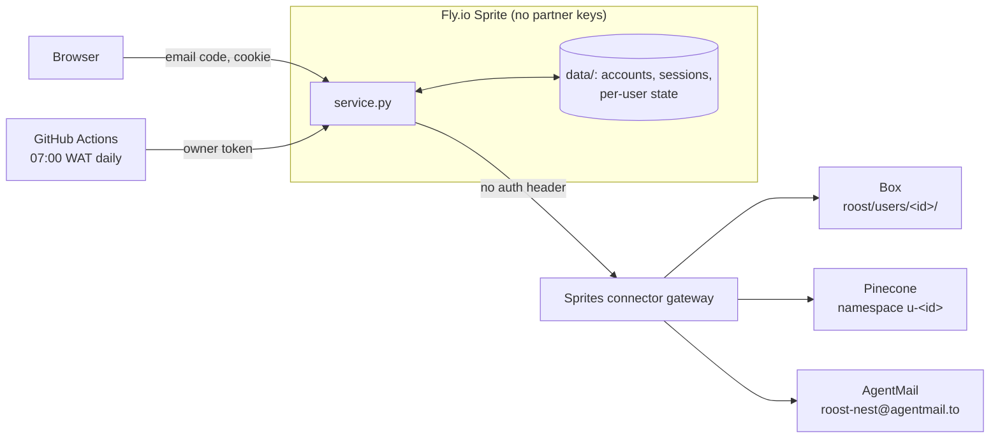

# roost

**Never miss what your documents say is due.** Add your bills, bookings and letters; roost finds every deadline written in them and emails you the morning something is coming up.

roost runs on a [Fly.io Sprite](https://fly.io/sprites/). Your files live in **Box**, roost remembers them in **Pinecone**, and email goes through **AgentMail**, all through Sprites connectors, so the server holds no passwords or API keys. The dates come from fixed rules over your own words, not a language model.

Built for [Hacksgiving 2026](https://fly.io/hacksgiving/).

**Try it:** https://roost-b6xbd.sprites.app

1. Sign in with your email. There's no password: roost emails you a 6-digit code (check spam).
2. Press **Try sample documents**, or add your own PDF, Word, Markdown or text files. You can also forward a bill by email to `roost-nest@agentmail.to` from the address you signed in with.
3. **Coming up** lists every dated thing to do across your documents, soonest first, with the exact line it came from.
4. Leave **Email me what's due** on and roost emails you each morning when something is due within a week. **Send me one now** shows you what that email looks like.
5. **Ask about your documents** answers a question with the file, the to-do and the date. **Delete my account** removes everything you added.

> This is a hackathon demo: files are stored in the roost owner's Box account, so don't add anything sensitive. Everything is deleted after 1 December 2026. Room for 40 people, 10 files (10 MB) each.

## How it works



- **Sign in** ([`accounts.py`](accounts.py)): an email with a 6-digit code and a one-time link, both valid once for 15 minutes. Codes, links and sessions are stored only as SHA-256 hashes. Limits: 5 wrong codes, 3 sign-in emails per address per hour, 20 per hour overall, 40 accounts. Sessions are 30-day `HttpOnly; Secure; SameSite=Lax` cookies, and every `POST /api/*` must carry `X-Requested-With: roost`, which a cross-site form can't send.
- **Your space** ([`userspace.py`](userspace.py)): your files go in your own Box folder (`roost/users/<id>/`) and your own Pinecone namespace (`u-<id>`). Uploads are checked against the limits before anything reaches Box. Removing a document deletes its vectors and empties the file in Box (the connector can't delete).
- **Reading documents** ([`extract.py`](extract.py), [`ingest.py`](ingest.py)): Markdown and text as is, Word `.docx` through `zipfile` and XML (headings and lists kept), PDF through `pdftotext` (poppler-utils on the Sprite). Text is split into heading-prefixed chunks, embedded with Pinecone's hosted `llama-text-embed-v2`, and stored with the chunk text. Box `sha1`s mean an unchanged file is never embedded twice.
- **Finding what's due** ([`due.py`](due.py)): a line counts when it has a date *and* a deadline word (due, by, before, until, expires, renews, pay, book, cancel, notice, ends, submit, return, appointment, check-up, departs, …). To-dos under a "To do" / "Next steps" / "Follow-ups" heading win over plain lines. Each item gets the next upcoming date it names, how many days away that is, urgency (≤ 7 days urgent, ≤ 30 soon, later can wait) and a next step (Do it now, Chase it up for call/chase/confirm lines, Plan it in). Overdue items stay listed for 14 days.
- **Forward a bill** ([`inbox.py`](inbox.py)): email sent to `roost-nest@agentmail.to` from your sign-in address becomes a `.txt` document the next time roost checks (**Check for changes**, or the daily run). Only the text is read: the AgentMail connector doesn't forward attachment downloads, so attachments are reported back as "upload this instead". Mail from unknown addresses is ignored.
- **Reminders** ([`digest.py`](digest.py), [`.github/workflows/daily.yml`](.github/workflows/daily.yml)): Sprites have no cron, so a GitHub Actions schedule calls `POST /internal/sync-all` (read forwarded mail, re-read Box) then `POST /internal/digest` (one email per user per day, only when something is due within 7 days). Email has a daily budget: 88 for users and 10 for tests, under AgentMail's free 100.
- **Asking** ([`ask.py`](ask.py), [`rerank.py`](rerank.py), [`decide.py`](decide.py)): the question is embedded and the 8 closest chunks found in your namespace. Pinecone's `bge-reranker-v2-m3` (through the connector, keyless) then re-scores them for how well each answers the question. It's answered when the reranker is sure (≥ 0.10), or when similarity passes 0.28 and the reranker doesn't reject it (≥ 0.002). Below that roost says it found nothing rather than guess. The whole best file is then read back and a fixed rules engine picks the file, category, the best-matching to-do, its date, priority and next action. The reranker has a monthly allowance (Starter: 500); roost counts its use (430 for users, 20 for tests) and falls back to similarity alone when it's spent or fails. Each answer says which was used (`ranked_by`).

## Connectors used

| Connector | Used for |
| --- | --- |
| **Box** | per-user folders, upload, download, replace content (`/2.0/folders`, `/2.0/files/<id>/content`, `upload/files/content`) |
| **Pinecone** | hosted embeddings (`/embed`), reranking (`/rerank`), and the vectors API on the `roost-nest` index, one namespace per user |
| **AgentMail** | sign-in codes and reminder emails (`/messages/send`), and reading forwarded bills (list and get messages) |

Connection URLs are discovered at runtime from `https://api.sprites.dev/v1/gateway/list`, so none are hard-coded.

## What we learned about Sprites connectors (Nov 2026)

- **Box:** list, download, folder create, upload and replace content are forwarded; **rename and delete are not** (403). Removing a file means emptying it.
- **Pinecone:** inference (`/embed`, `/rerank`) and the vectors API are forwarded, but **not index creation or the 2026-07 documents API**. Console-made indexes now get a document schema only that API can read, so roost uses a plain dense index created through the API ([`scripts/create-index.sh`](scripts/create-index.sh)).
- **AgentMail:** send, list messages, get message and get thread are forwarded; **attachment downloads are not** ("endpoint is not supported by the AgentMail connector").
- **The gateway sometimes answers 503.** roost retries GETs twice.
- **A running service keeps a Sprite awake**, and a stopped one did not auto-start on request for us, so roost runs as an always-on service. There is no cron: the schedule lives in GitHub Actions.

## Run it yourself

You need a Fly.io account with the [`sprite` CLI](https://docs.fly.io/sprites), and free Box, Pinecone and AgentMail accounts.

1. **Create the Sprite:**

   ```sh
   sprite login
   sprite create --skip-console --label env=hacksgiving roost && sprite use roost
   sprite exec --no-stdin -- sudo apt-get install -y poppler-utils   # PDF support (optional)
   ./scripts/deploy.sh   # pushes the code; the first time it stops and asks you to create the service:
   sprite exec --no-stdin -- sprite-env services create roost --cmd python3 \
     --args /home/sprite/roost/service.py --dir /home/sprite/roost --http-port 8080
   sprite config update --url-auth public
   ```

2. **Connect Box, Pinecone and AgentMail:** Fly dashboard → Connectors, then grant each to the label `env=hacksgiving` under **Sprite Labels**. Scope the AgentMail key to one inbox and set `ROOST_INBOX` if it isn't `roost-nest@agentmail.to`.
3. **Create the index:** put `PINECONE_API_KEY=...` in a local `.env` (gitignored) and run `./scripts/create-index.sh`.
4. **Create a `roost` folder** in your Box root. User folders are made inside it.
5. **Set the owner token:** `./scripts/set-token.sh` puts `ROOST_TOKEN` in `.env` and installs only its hash on the Sprite. Add the same value as the `ROOST_TOKEN` secret in your GitHub repository for the daily workflow.
6. **Check it:** `./scripts/smoke.sh` runs one real pass on the Sprite (sign-in through the inbox, samples, due list, upload, ask, a forwarded bill, a test reminder, removal) and then deletes its own account. It runs once per deployed code version; `--force` repeats it.

After changing the code: `./scripts/deploy.sh` (or `./scripts/deploy.sh api` to leave the live page alone), and `python3 scripts/preview.py` to see the page locally against the live API at http://localhost:8765.

## Tests

```sh
python3 -m unittest discover -s tests -t .
```

88 tests, no network: Box, Pinecone, AgentMail and the inbox are faked ([`tests/fakes.py`](tests/fakes.py)). They cover sign-in (codes, links, expiry, lockout, rate limits, the user cap, test sign-ins), sessions and CSRF, per-user isolation, upload limits and names, deadline extraction from the sample documents, Word and PDF-style text, forwarded email, reranking with its budget and fallback, the digest and email budgets, account deletion, and the HTTP API end to end.

## Layout

| File | Role |
| --- | --- |
| `service.py` | HTTP server and routes, cookies, CSRF check, error mapping, page security headers |
| `web/index.html` | the whole page (inline CSS and JS, no build); design in [`DESIGN.md`](DESIGN.md) |
| `accounts.py` | users, sign-in codes and links, sessions, limits |
| `userspace.py` | one user's documents, limits, due list, questions, erase |
| `extract.py`, `ingest.py` | text from md/txt/docx/pdf; chunking and Box → Pinecone sync |
| `due.py` | dated to-dos and the Coming up list |
| `decide.py`, `ask.py` | the rules engine for questions |
| `mail.py`, `digest.py`, `inbox.py` | sending with budgets, the daily email, forwarded mail |
| `gateway.py`, `box.py`, `nest.py`, `auth.py`, `store.py` | connector calls, Box and Pinecone clients, owner token, atomic JSON files |
| `scripts/` | deploy, smoke test, local preview, token and index setup |

Python standard library only, with no dependencies to install.

## After judging

All user data is deleted after 1 December 2026: `POST /internal/delete-user` with `{"all": true}` and the owner token, then the `roost/users` folder is deleted by hand in Box (the connector can't delete).
