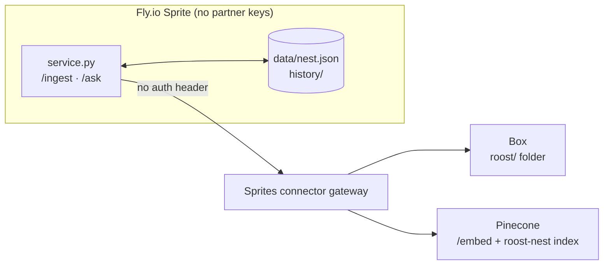

# roost

A personal archivist agent that lives on a [Fly.io Sprite](https://fly.io/sprites/). It pulls your own documents from **Box**, keeps them as vector memory in **Pinecone** (the "nest"), and answers questions with a typed, structured decision: which file answers you, what kind of document it is, how urgent it is, and what to do next.

The Sprite holds no partner credentials. Every Box and Pinecone call goes through the Sprites connector gateway.

Built for [Hacksgiving 2026](https://fly.io/hacksgiving/).

```console
$ curl -G -H "X-Roost-Token: $ROOST_TOKEN" --data-urlencode "q=when does my car insurance renew" \
    https://roost-b6xbd.sprites.app/ask
```

```json
{
  "answered": true,
  "source_file": "car-insurance-renewal.md",
  "category": "finance",
  "priority": "medium",
  "next_action": "follow_up",
  "due": "2026-12-10",
  "action_item": "Call Harbourline before 10 December to negotiate; otherwise switch to Bramble.",
  "confidence": 0.5,
  "summary": "car-insurance-renewal.md answers this. Finance, medium priority: Call Harbourline before 10 December to negotiate; otherwise switch to Bramble. (due 10 Dec 2026)"
}
```

The response also includes `evidence` (the best-matching passage) and `matches` (the top files and scores).

## How it works



- **`POST /ingest`** lists the Box `roost/` folder and downloads `.md`, `.markdown` and `.txt` files. It splits them into chunks along their headings and embeds them with Pinecone's hosted `llama-text-embed-v2`. The vectors are stored in the `roost-nest` index, with the chunk text alongside each one. `data/nest.json` records each file's Box `sha1`, so a re-run only touches files that were added, changed or deleted in Box. An unchanged re-run does no embedding at all.
- **`GET /ask?q=...`** embeds the question and finds the 8 closest chunks. If the best match scores at least 0.28, roost reads that whole file back from Pinecone and makes the decision. Each answer is appended to `data/history/`.
- **The decision is fixed rules, not a language model** ([`decide.py`](decide.py)). Every field comes from your own documents:

  | Field | Rule |
  | --- | --- |
  | `answered` | best match score ≥ 0.28 (on-topic questions scored 0.36–0.50 in testing, off-topic ≤ 0.18) |
  | `category` | keyword counts over the file: `home`, `finance`, `health`, `travel`, `purchases`, `personal`, `work`, `other` |
  | `action_item` | the bullet under a "To do" / "Next steps" / "Follow-ups" heading that best matches the question; ties go to the most urgent |
  | `due` | the date written in that to-do |
  | `priority` | due within 7 days → `high`, within 30 → `medium`, otherwise `low`; "this week" / "asap" → `high` |
  | `next_action` | `act_now` (high), `follow_up` (chase / call / confirm…), `schedule`, `review` (no open to-do), `none` (not answered) |
  | `summary` | a template over the fields above |

  No model means no cost per question, the same answer every time, and none of your document text leaving Box and Pinecone.
- **Auth:** `/ingest` and `/ask` require an `X-Roost-Token` header. The token stays on your laptop. The Sprite stores only its SHA-256, and `/ingest` and `/ask` return 503 until one is installed. `/healthz` is open.

## Connectors used

| Connector | Used for |
| --- | --- |
| **Box** | list the `roost/` folder, download files (`/2.0/folders/<id>/items`, `/2.0/files/<id>/content`) |
| **Pinecone** | hosted embeddings (`/embed`), plus storing, searching, fetching and deleting vectors (`/indexes/roost-nest/...`) |

Connection URLs are discovered at runtime from `https://api.sprites.dev/v1/gateway/list`, so none are hard-coded.

## What we learned about Sprites (Nov 2026)

- **The Pinecone connector forwards inference and the vectors API, but not index creation or the 2026-07 documents API.** Indexes created in the Pinecone console now get a document schema, which only the documents API can read. roost therefore uses a plain dense index created through the API ([`scripts/create-index.sh`](scripts/create-index.sh)) and embeds through `/embed`.
- **A running service keeps a Sprite awake.** We expected the service to auto-start on request after it had been stopped, but it didn't. So roost runs as an always-on service.
- **The Sprite runs as user `sprite`**, so the code lives in `/home/sprite/roost`.
- **roost is triggered, not scheduled.** Sprites have no native cron, so ingest and ask run when called. A phone shortcut or an external cron hitting `/ingest` would make it a daily archivist.

## Run it yourself

You need a Fly.io account with the [`sprite` CLI](https://docs.fly.io/sprites), a Box account, and a Pinecone Starter account. Everything here runs on free tiers.

1. **Create the Sprite and deploy:**

   ```sh
   sprite login
   sprite create --skip-console --label env=hacksgiving roost && sprite use roost
   sprite exec --no-stdin -- mkdir -p /home/sprite/roost
   for f in service.py auth.py gateway.py box.py nest.py ingest.py decide.py ask.py; do
     sprite file push "$f" "/home/sprite/roost/$f"
   done
   sprite exec --no-stdin -- sprite-env services create roost --cmd python3 \
     --args /home/sprite/roost/service.py --dir /home/sprite/roost --http-port 8080
   sprite config update --url-auth public
   ```

2. **Connect Box and Pinecone:** Fly dashboard → Connectors. Connect Box (sign in) and Pinecone (paste your API key). Under **Sprite Labels**, grant each one to `env=hacksgiving`.
3. **Create the index:** put `PINECONE_API_KEY=...` in a local `.env` (gitignored), then run `./scripts/create-index.sh`.
4. **Add documents:** create a folder called `roost` in your Box root and upload some `.md` or `.txt` files. [`sample-docs/`](sample-docs) has eight fictional ones.
5. **Set the token:** `./scripts/set-token.sh` puts `ROOST_TOKEN` in `.env` and installs its hash on the Sprite.
6. **Use it:**

   ```sh
   export ROOST_TOKEN=$(grep '^ROOST_TOKEN=' .env | cut -d= -f2-)
   curl -X POST -H "X-Roost-Token: $ROOST_TOKEN" https://<your-sprite-url>/ingest
   curl -G -H "X-Roost-Token: $ROOST_TOKEN" --data-urlencode "q=what should I sort out before the trip" https://<your-sprite-url>/ask
   ```

After changing the code, `./scripts/deploy.sh` pushes it and restarts the service.

## Tests

```sh
python3 -m unittest discover -s tests -t .
```

The 32 tests use fake Box and Pinecone clients, so they need no network. They cover ingest syncing (adds, edits, renames, deletions, re-runs that change nothing), chunking, date parsing, auth, and the rules engine run against the sample documents.

## Layout

| File | Role |
| --- | --- |
| `service.py` | HTTP server (stdlib `http.server`), routes, error mapping |
| `auth.py` | `X-Roost-Token` check against the stored hash |
| `gateway.py` | connector discovery and keyless HTTP calls |
| `box.py`, `nest.py` | Box and Pinecone clients |
| `ingest.py` | chunking and Box → nest sync |
| `decide.py`, `ask.py` | rules engine; search → decide → history |

Python standard library only, with no dependencies to install.
